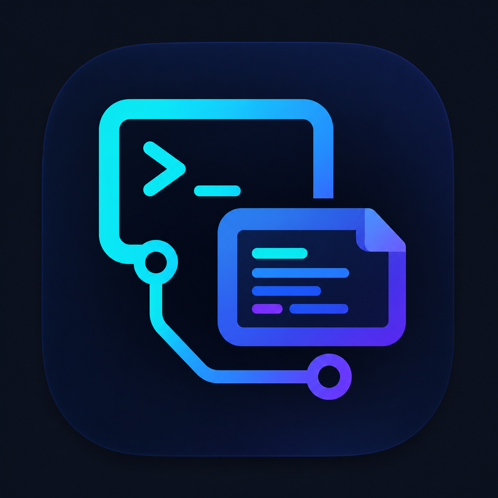

<p align="center">
  
</p>

# Termlet ⚡ 🖥️

> A blazing-fast, modern cross-platform desktop **SSH terminal**, **dual-pane SFTP remote file browser**, and **syntax-highlighted code editor** designed for developers and sysadmins.

Built with **Go (Wails v2)** + **React 19** + **TypeScript** + **Tailwind CSS v4** + **CodeMirror** + **Base UI / Shadcn**.

---

[](LICENSE)
[](https://golang.org)
[](https://wails.io)
[](https://react.dev)
[](https://www.typescriptlang.org)
[](#target-platforms)

---

## ✨ Features

### 🪟 Modern Frameless Window & Integrated Controls
- **Custom Frameless Title Bar**:
  - Replaces native OS chrome with an integrated, theme-adaptive title bar.
  - Tactile window controls: **`—` Minimize**, **`□` Maximize / Restore**, and **`✕` Close**.
  - **Dynamic Maximize/Restore Toggle**: Smoothly switches between single square and dual-rectangle restore icons.
  - **Double-Click Titlebar**: Double-clicking the draggable header toggles maximize and restore.
  - **Window Dragging**: Smooth OS window movement via designated `.wails-drag` and `.wails-no-drag` regions.
  - **Live Connection Pill**: Displays the currently active connection (`username@host:port`) with a pulsing emerald pulsation dot and quick-disconnect dropdown right inside the title bar.

### ⚡ Full-Featured SSH Terminal & Profiles
- **Profile Manager**: Save and organize multiple remote servers with custom profile names, hostnames, ports, usernames, and authentication methods.
- **Multiple Authentication Modes**: Supports passwords, encrypted private keys with passphrases (`id_rsa`, `id_ed25519`), and local SSH Agent forwarding (`$SSH_AUTH_SOCK`).
- **Host Key Verification**: Interactive security modal for new and changed server host keys with SHA256 fingerprints and MITM warnings.
- **Fast Session Switching**: Switch between active servers and terminal tabs without losing working state.
- **Configurable Fonts & Steppers**: Custom font size stepper with 1-click increment/decrement, JetBrains Mono font integration, and customizable tab indentation (2, 4, 8 spaces).

### 📁 Dual-Pane SFTP Remote File Browser
- **Remote File Tree**: High-speed SFTP tree exploration with file type icons, directory expansion, and recursive folder traversal.
- **File Management**: Create files, create directories, rename files, and delete with safety prompts.
- **1-Click Uploads**: Upload local files directly into any remote directory via the integrated file picker.
- **Context Menus**: Right-click or `•••` action dropdowns for quick file operations, path copying, and deletion.

### 📝 Integrated Syntax-Highlighted Remote Code Editor
- **Multi-Tab Workspace**: Open and edit multiple remote files simultaneously alongside settings.
- **Rich Syntax Highlighting**: Powered by **CodeMirror 6** with language detection across Python, JavaScript, TypeScript, Go, Rust, C/C++, HTML, CSS, JSON, YAML, Shell, Markdown, and more.
- **Instant Remote Save**: Save directly to the remote server using <kbd>Ctrl + S</kbd> / <kbd>Cmd + S</kbd> with dirty state indicators (`●`).
- **Editor Preferences**: Customizable editor themes (VS Code Dark, GitHub Dark, GitHub Light, Tokyo Night, Dracula, Nord, Monokai), line numbers toggle, and soft word wrap.
- **Binary File Detection**: Safeguards against opening binary executables or archives into text buffers.

### 🎨 Polished Dual-Theme System (Light & Dark Mode)
- **High-Contrast Design**: WCAG AA compliant contrast across both Dark Mode (`zinc-950`) and Light Mode (`zinc-50`).
- **Custom Numeric Steppers**: Handcrafted tactile font size steppers (`- [ 13 ] + px`) and sanitized numeric inputs, eliminating native WebKitGTK white spinner box artifacts on Linux.
- **Instant Search Settings**: Full-text filterable settings dashboard with responsive, centered search controls.

### 🔄 In-App Self-Updates & Release Management
- **Background Release Detection**: Automatic GitHub Releases checking with non-intrusive notification toasts.
- **In-App Version Check**: Query current version and check for newer releases with 1 click directly in Settings.

---

## 🏗️ Architecture

```
termlet/
├── app.go                      # Wails RPC backend bridge binding SSH, SFTP, and Settings
├── main.go                     # Wails application entrypoint & frameless window configuration
├── internal/
│   ├── ssh/                    # SSH client, PTY session manager & authentication
│   ├── sftp/                   # SFTP remote file operations & directory traversal
│   ├── config/                 # Profile storage & application settings
│   ├── updater/                # GitHub release detection & update checker
│   └── version/                # Semantic version constant (v0.5.0)
├── frontend/                   # React 19 + TypeScript + Tailwind CSS v4 + CodeMirror
│   ├── src/
│   │   ├── components/         # TitleBar, RemoteFileTree, CodeEditor, EditorTabs, ConnectDialog, SettingsView, WelcomeScreen
│   │   ├── types/              # TypeScript models (remote files, sessions, settings)
│   │   ├── style.css           # Tailwind v4 theme definitions and GTK spinner suppression
│   │   ├── App.tsx             # Main dashboard coordinator & state management
│   │   └── main.tsx
│   └── wailsjs/                # Auto-generated RPC bindings between Go and TypeScript
├── build/                      # Build assets, application icons, and packaging specs
│   ├── linux/                  # Linux desktop launcher and NFPM packaging configuration
│   └── windows/                # Windows icon and manifest
└── .github/workflows/          # Cross-platform CI/CD release workflow (Linux, Windows, macOS)
```

---

## 🚀 Getting Started

### Prerequisites
- **Go**: `1.24+`
- **Node.js**: `20+` & `npm`
- **Wails CLI**: `v2.9+` (`go install github.com/wailsapp/wails/v2/cmd/wails@latest`)

#### Linux Build Dependencies
On Debian, Ubuntu, Linux Mint, or Pop!_OS:
```bash
sudo apt-get update
sudo apt-get install -y build-essential pkg-config libgtk-3-dev libwebkit2gtk-4.1-dev
```

On Fedora, RHEL, or CentOS:
```bash
sudo dnf install -y gtk3-devel webkit2gtk4.1-devel
```

---

### Installation & Development

1. **Clone the repository**:
   ```bash
   git clone https://github.com/Amanbig/termlet.git
   cd termlet
   ```

2. **Install frontend dependencies**:
   ```bash
   cd frontend
   npm install
   cd ..
   ```

3. **Run in Live Development Mode**:
   ```bash
   wails dev -tags webkit2_41
   ```
   *(On non-Linux systems or older WebKit, you can run `wails dev`)*

---

## 📦 Production Build

To compile a standalone production binary for your operating system:

```bash
wails build -tags webkit2_41
```

The compiled desktop binary will be placed inside `build/bin/termlet`.

### Target Platforms

| Platform | Formats Generated |
| :--- | :--- |
| **Linux (amd64)** | Native binary, `.deb` (Debian/Ubuntu), `.rpm` (Fedora/RHEL), `.tar.gz` |
| **Windows (amd64)** | Standalone `.exe`, `.zip` archive |
| **macOS (Universal)** | Universal binary (Apple Silicon + Intel), `.dmg`, `.zip` |

---

## 📋 Release History & Notes

For detailed changelogs and highlights of each release, see:
- [RELEASE_NOTES.md](RELEASE_NOTES.md) — Active release highlights
- [releases/](releases/) — Historical version archive index

---

## 📄 License

This project is licensed under the **Apache 2.0 License** — see the [LICENSE](LICENSE) file for details.
