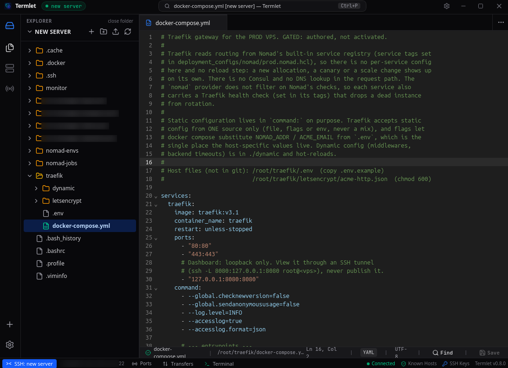

# Termlet v0.8.0 💻

  

Termlet **v0.8.0** introduces a high-performance, interactive **Remote SSH Command Runner & Terminal Drawer** with stateful working directory persistence, live SFTP directory tree synchronization, interactive TTY interception, and instant cancellation.

---

### ✨ What's New & Highlights

#### 💻 Interactive Remote SSH Terminal Runner & Drawer
- **Persistent Bottom Terminal Drawer**:
  - Open a sleek, embedded remote terminal runner directly beneath your SSH file workspace using the shortcut `Ctrl+\`` or the bottom Status Bar **Terminal** toggle button.
  - Seamlessly runs remote shell commands against the active SSH connection without needing an external terminal emulator or third-party tools.
- **Stateful Remote Working Directory Tracking (`cd` Persistence)**:
  - Preserves working directory across command executions. If you execute `cd /var/log && pwd`, subsequent commands execute within `/var/log`.
  - Captures the exact physical directory using POSIX-compliant `pwd -P` and cleanly propagates working directory changes.
- **Bi-directional SFTP Explorer & Workspace Synchronization**:
  - Whenever the remote directory changes inside the terminal runner (e.g. `cd /etc/nginx`), Termlet's remote SFTP tree and navigation breadcrumb automatically sync and reload to that directory in real time.
- **Interactive TTY Interception & Smart Editor Hints**:
  - Inline subshells cannot run full-screen interactive curses/TTY applications without freezing or sending unprintable terminal escape sequences.
  - Commands requiring an interactive TTY (e.g. `vim`, `vi`, `nvim`, `nano`, `emacs`, `top`, `htop`, `btop`, `less`, `more`, `man`) are intelligently intercepted before execution.
  - Termlet provides an actionable hint suggesting the graphical inline code editor, Quick Open (`Ctrl+P`), or non-interactive alternatives like `cat` or `ps aux`.
- **Instant In-Flight Command Interruption (`Ctrl+C` / UI Cancel)**:
  - Stop running commands immediately by pressing `Ctrl+C` or clicking the **Cancel** button.
  - Closes the active SSH execution channel instantly without dropping the main SSH connection or disrupting file transfers.
  - Respects standard clipboard text selection when pressing `Ctrl+C`.
- **Exit Code Reporting & Error Styling**:
  - Displays exit codes for commands that return non-zero exit statuses.
  - Failed command output is styled with a distinct rose accent and border (`border-rose-500/30`), while quiet commands that exit non-zero (such as `false` or `diff`) display explicit `[Process exited with code X]` tags.
- **Output Safety & Memory Limits**:
  - Strips ANSI color codes for clean typography.
  - Protects webview DOM performance by truncating outputs exceeding 100,000 characters with an alert marker.
- **Terminal History & Productivity Shortcuts**:
  - Browse command history with `Up` and `Down` arrow keys.
  - Quick screen clear via `clear` command, `Ctrl+L`, or the trash button.
  - One-click **Copy All Output** to clipboard.
  - Maximize / restore height toggle buttons.

---

### 📦 Artifacts Included
- **Linux**:
  - `termlet-linux-amd64.deb` (Debian, Ubuntu, Linux Mint, Pop!_OS)
  - `termlet-linux-amd64.rpm` (Fedora, RHEL, CentOS, openSUSE)
  - `termlet-linux-amd64.tar.gz` (Portable Linux archive)
- **Windows**:
  - `termlet-windows-amd64.zip` (Portable 64-bit Windows archive)
- **macOS**:
  - `termlet-darwin-universal.dmg` (Intel & Apple Silicon)
